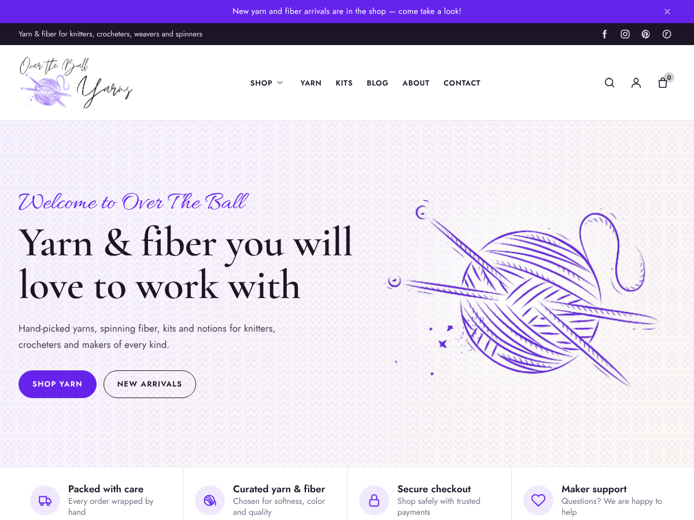

# OTBY
Over The Ball Yarns site theme

A custom WordPress theme for [overtheballyarns.com](https://overtheballyarns.com/), an online yarn and fiber shop. The colors come from the Over The Ball Yarns logo: violet yarn (`#6623EB`) and ink-black script (`#1B1525`), with lavender and cream surfaces and an Allura script accent echoing the hand-lettering. The logo ships with the theme and becomes the site logo and site icon on activation.



## Install

```sh
bin/build-zip.sh          # creates dist/overtheball.zip
```

Upload `dist/overtheball.zip` in **Appearance → Themes → Add New → Upload Theme** and activate it.

On activation the theme copies **every picture from the theme that was active before it** into the Media Library. That covers the old theme's image folders plus the pictures set in its Customizer. It then places them in the homepage hero, promo banner, about section and title banner, and shows all of them in the homepage picture gallery. Review or re-run this in **Appearance → Over The Ball → Pictures**, or with `wp overtheball pictures import`. Pictures copied into `overtheball/assets/images/library/` can be imported the same way.

## What's included

| Area | Highlights |
| --- | --- |
| Theme settings | 7 Customizer panels plus WooCommerce sections (≈285 controls): layout, sidebars, title banner, colors (live preview), typography, announcement bar, top bar, 3 header layouts, sticky/transparent header, footer columns, newsletter strip, homepage sections + drag-and-drop order, blog, contact/social/forms, performance. Settings export / import / reset. |
| Menu locations | Primary (with `mega-menu` class support), Top Bar, Mobile, Footer Links, Footer Bottom / Legal |
| Sidebar locations | Blog, Page, Shop (mobile filter drawer), Product, Top Bar, Header, Mobile Menu Drawer, Before Footer, Footer Columns 1–4 |
| Header options | Classic / Boutique (centered) / Shop (search bar) layouts, sticky + shrink, transparent over hero, search overlay, account & cart icons, slide-out cart, rotating dismissible announcement bar, configurable top bar, mobile breakpoint and drawer side |
| Footer options | 0–4 widget columns with width presets, brand block (light logo, about, social), newsletter strip, copyright tokens, payment methods, legal menu, distraction-free checkout footer |
| WooCommerce | Yarn Details product tab (CYC weight, fiber, yardage, gauge, needles, hook, care), spec chips, skein calculator, dye-lot notice, shop by weight, sale %, New / Sold out badges, hover image, mini-cart drawer with free-shipping progress, sticky add to cart, quantity buttons, catalog mode, styled cart/checkout blocks and account area |
| Contact Form 7 | Themed forms, Contact page template (details, form, map), optional on-demand assets |
| MailPoet | Themed signup forms in the footer strip and homepage, automatic form detection |
| Elementor | Pro Theme Builder locations, Header Footer Elementor, Hide Title support, Blank Canvas / Full Width templates, per-page full-width content, theme sections as shortcodes |

See [`overtheball/readme.txt`](overtheball/readme.txt) for the full settings reference, shortcodes and WP-CLI commands.

## Design references

Patterns from established yarn brands and shops informed the layout:

* [Berroco](https://berroco.com/): pattern-forward storytelling and shop-by-weight/fiber navigation.
* [Knitter's Pride](https://www.knitterspride.com/): product collections and tool categories.
* [Get Knit Faced](https://getknitfacedinco.com/): indie-dyer colorways and dye-lot notes.
* [Cottage Yarns](https://www.cottageyarns.com/): local-shop warmth, contact and hours.
* [Cascade Yarns](https://www.cascadeyarns.com/): yarn spec tables (weight, yardage, gauge, needle size).

## Requirements

WordPress 6.4+ (tested on 7.1), PHP 7.4+, WooCommerce 8+ (tested on 11.2).
